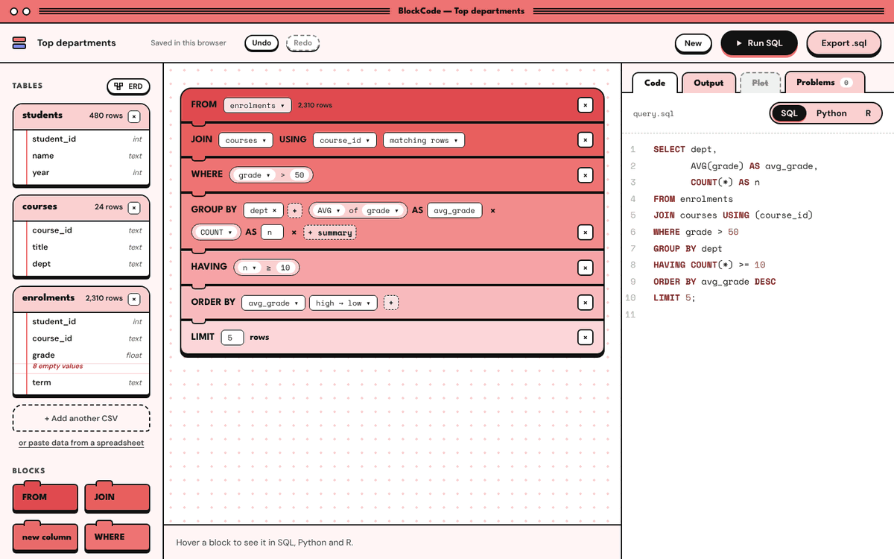
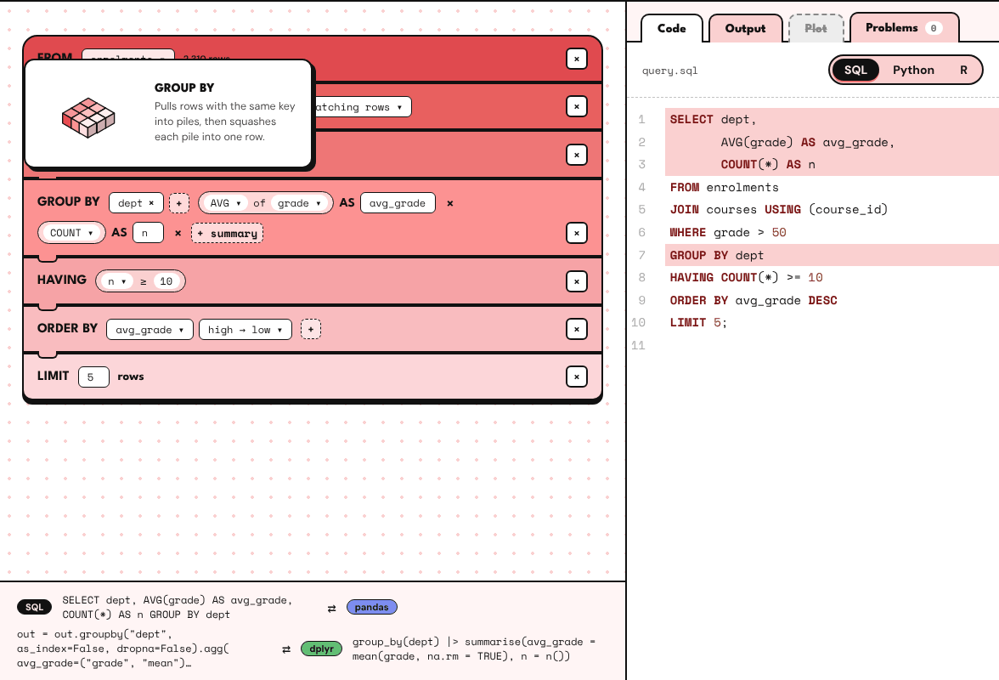
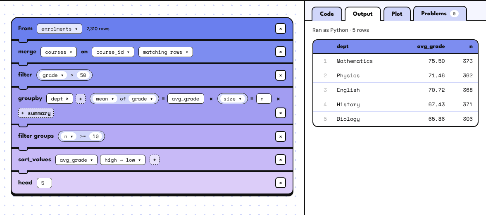
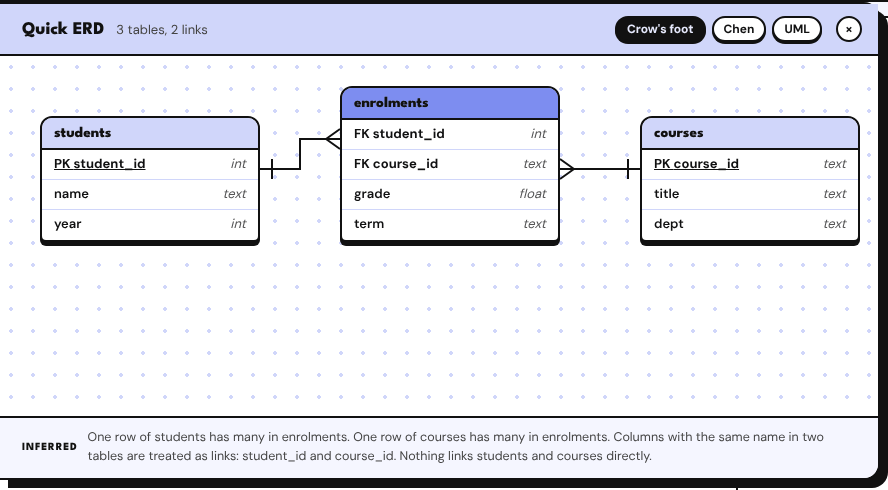
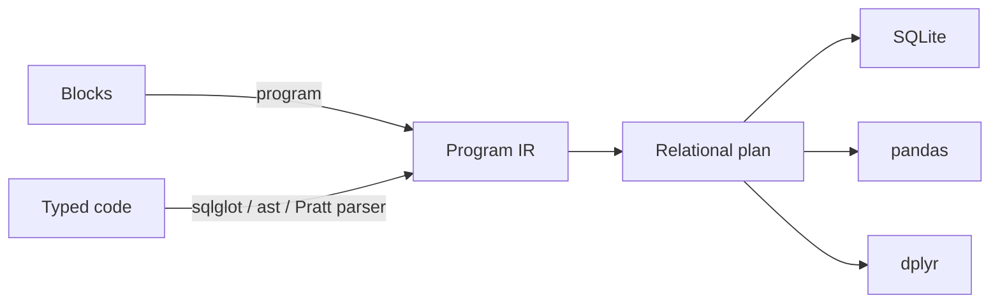

<div align="center">

# BlockCode

**Snap blocks together and read the real code, in SQL, Python or R.**

[](https://github.com/saf-azad/BlockCode/actions/workflows/ci.yml)
[](https://blockcode-psi.vercel.app)
[](pyproject.toml)
[](web/package.json)
[](LICENSE)

[**Try it live**](https://blockcode-psi.vercel.app) · [Architecture](docs/ARCHITECTURE.md) · [Run it locally](#quick-start)



<sub>One stack of blocks, three languages. Switching language rewrites the code and leaves the blocks alone.</sub>

</div>

---

BlockCode is a Scratch-style editor for learning data work. Drop in a CSV, snap blocks into a
stack, and read the matching code as you build it, in **SQL**, **Python (pandas)** or
**R (dplyr / Quarto)**. It works in both directions: type or paste code in the Code tab and the
blocks rebuild themselves.

Learners who struggle to write valid SQL, pandas or dplyr usually struggle with the same few
ideas (joins, grouping, filtering before or after a summary) in three different syntaxes.
BlockCode teaches the ideas once, as blocks, and shows how each language spells them.

## Features

- **Blocks ⇄ code, both ways.** Building blocks writes code. Typing code builds blocks. Anything
  in Python or R that can't be a block yet is kept as a dashed "Code" block, so nothing typed is
  lost.
- **One program, three languages that agree.** The blocks have no language of their own. The
  test suite checks that SQL, pandas and R return the same table for every example program.
- **Hover to learn.** Hovering a block highlights the lines it wrote and shows that step in all
  three languages at once. A small animation shows what it does to the rows.
- **Errors point at blocks.** A Python traceback or an R error is traced back through a source map
  to the block that caused it, in plain English: *"best is used before it has a value."*
- **Messy CSVs welcome.** Other encodings, semicolons, `NA` / `N/A` / `null`, `1,234`, decimal
  commas and ragged rows are all tidied on the way in, so every language reads the same table.
- **Private by design.** The server keeps nothing. Each visitor's work is saved in their own
  browser.
- **Take the code with you.** Export a standalone `.sql`, `.py`, or `.R` / `.qmd` with its data.
  It runs without BlockCode.

<p align="center">
  
</p>

<table>
  <tr>
    <td width="50%"></td>
    <td width="50%"></td>
  </tr>
  <tr>
    <td align="center"><sub>Run in any language and see the result</sub></td>
    <td align="center"><sub>An ERD inferred from the data (crow's foot, Chen or UML)</sub></td>
  </tr>
</table>

## How it works



Blocks and code are two views of one **Program IR**. Every From stack is reduced to a single
relational plan (`Source → Join → Where → Group → Having → Select → Order → Limit`), and all three
code generators walk that same plan. That shared plan is why the three languages agree. Each
generated line is tagged with the blocks that wrote it, which drives hover highlights and
error-to-block links. Parsing code back to blocks uses sqlglot for SQL, Python's `ast` for
pandas, and a small hand-written Pratt parser for R.

**[Read the full architecture →](docs/ARCHITECTURE.md)**

## Engineering highlights

- **Correctness by cross-checking.** Nearly 400 engine tests, many of them checking that languages
  and directions agree with each other. [Hypothesis](https://hypothesis.readthedocs.io) generates
  random pipelines and asserts that `parse(generate(P))` regenerates identical code in every
  language, and that SQL and pandas return the same rows. Golden files cover every example, and
  10 Playwright journeys drive the real app end to end.
- **The animations are tested too.** Each hover animation's story lives in a JSON file. A test
  runs the same story through the real engine and checks that the rows the animation shows are
  the rows the engine returns.
- **Stable identity across re-parses.** As you type, newly parsed blocks are matched to the
  existing ones by slot, type and position, so hover state and settings survive every keystroke.
- **Stateless, privacy-first backend.** Runs and exports carry their (gzipped) CSVs. The server
  tidies them into a temporary folder, runs the code, and deletes everything. There's no
  database, nothing leaks between visitors, and it scales out on serverless hosts.
- **Careful with untrusted code.** Every program is shape-checked before any code is written,
  and every value from a block reaches the code as a quoted literal or a checked identifier. SQL
  runs on a read-only, time-limited connection. Python and R run in subprocesses with a clean
  environment and CPU, time, file-size and output limits. Running free-typed code is off by
  default on public deployments.

## Tech stack

| Layer | Built with |
| --- | --- |
| **Engine** | Python 3.11+, pydantic, sqlglot, pandas, matplotlib, SQLite |
| **API / CLI** | FastAPI, uvicorn, Typer |
| **Editor** | React 19, TypeScript, Vite, CodeMirror 6, dnd-kit |
| **Testing** | pytest, Hypothesis, Vitest, Playwright |
| **Tooling** | uv, ruff, GitHub Actions, Docker, Vercel |

## Quick start

Requires [uv](https://docs.astral.sh/uv/) and Node 22.

```bash
uv sync                                   # Python engine + server
(cd web && npm ci && npm run build)       # build the editor
uv run blockcode serve                    # open http://127.0.0.1:8000
```

R is optional. R code is always generated and exported, and it runs when `Rscript` (with dplyr,
readr, stringr and ggplot2) is installed. To try it with sample data, upload the CSVs in
[`blockcode/data/sample/`](blockcode/data/sample).

## Development

```bash
uv run pytest                             # engine, API, CLI and messy-CSV tests
uv run ruff check .                       # lint
(cd web && npm run dev)                   # Vite dev server, proxies /api to :8000
(cd web && npm test)                      # frontend unit tests
(cd web && npm run build && npm run e2e)  # browser tests against the real engine
```

The `blockcode` CLI works on projects in a folder on disk: `new`, `import-csv`, `code`,
`validate`, `run` and `export`. For example, `uv run blockcode new demo` creates a project with
the school sample data.

<details>
<summary><b>Project layout</b></summary>

```
blockcode/            Python engine
  ir.py registry.py     the Program IR and the block specs
  plan.py               From stack → relational plan, with column tracking
  codegen/              plan → SQL, pandas, dplyr (+ source maps)
  parse/                SQL, Python, R → IR; match.py keeps block ids stable
  run/                  runners and subprocess limits
  data_io.py            CSV tidying and type inference
  server.py cli.py      FastAPI app and the command line
web/src/              React editor
  stack/                blocks, pills and drag and drop
  code/                 the CodeMirror panel
  panels/ sidebar/      output, plots, problems; tables and the ERD
  explainers/           the hover animations
tests/                pytest suites, golden files and fixtures
docs/                 architecture notes, screenshots and the original design mockup
```

</details>

## Deploying

**Docker (all three languages).** The `Dockerfile` builds one image with the editor, the engine
and R. It listens on `$PORT` (default 8000), so it suits Render, Railway, Fly.io, Cloud Run or
any VPS.

```bash
docker build -t blockcode . && docker run -p 8000:8000 blockcode
```

**Vercel (SQL and Python).** `pyproject.toml` points Vercel at the FastAPI app, and its build
script compiles the editor into `public/`, so importing the repository into Vercel is all it
takes. Vercel has no R, so there the R tab shows and exports code but can't run it.

## Limits and safety

- A CSV can be up to 10 MB. Results show the first 200 rows. SQL and Python stop after 10
  seconds, and R after 20. A run returns at most 12 plots and 100,000 characters of output.
- Code typed in the Python or R tab can include lines that aren't blocks. Running those means
  running arbitrary code on the server, so `/api/run` refuses programs with a Code block unless
  `BLOCKCODE_ALLOW_RAW_CODE=1` is set. Only set it on a trusted or sandboxed host. Programs
  built only from blocks always run.
- For a public deployment, add a rate limit on `/api/*` (for example a Vercel Firewall rule of 20
  requests per minute per IP), and don't give the host secrets it doesn't need.

## License

[MIT](LICENSE)
