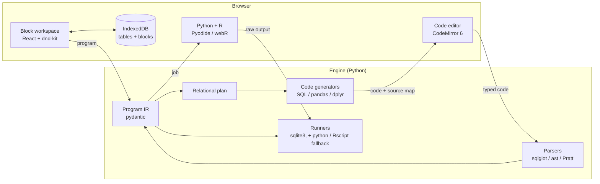
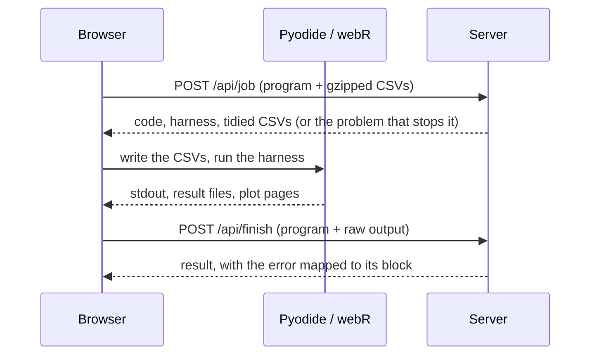
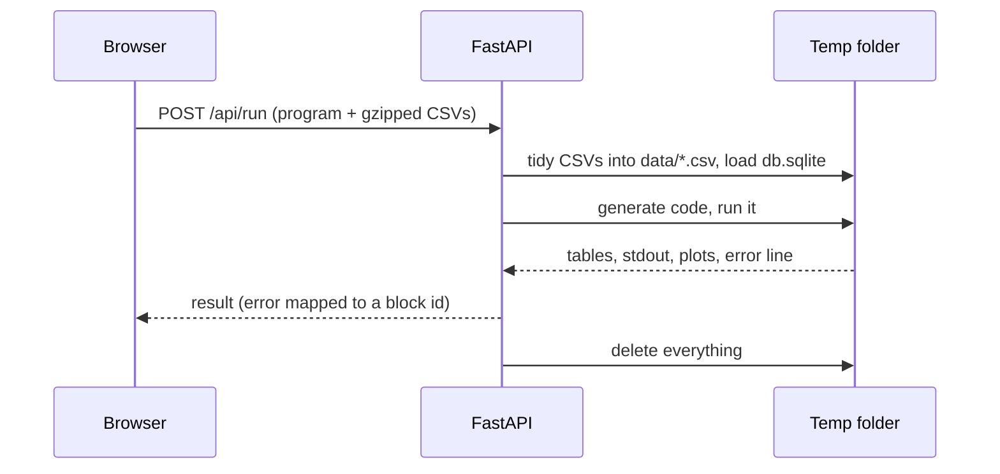
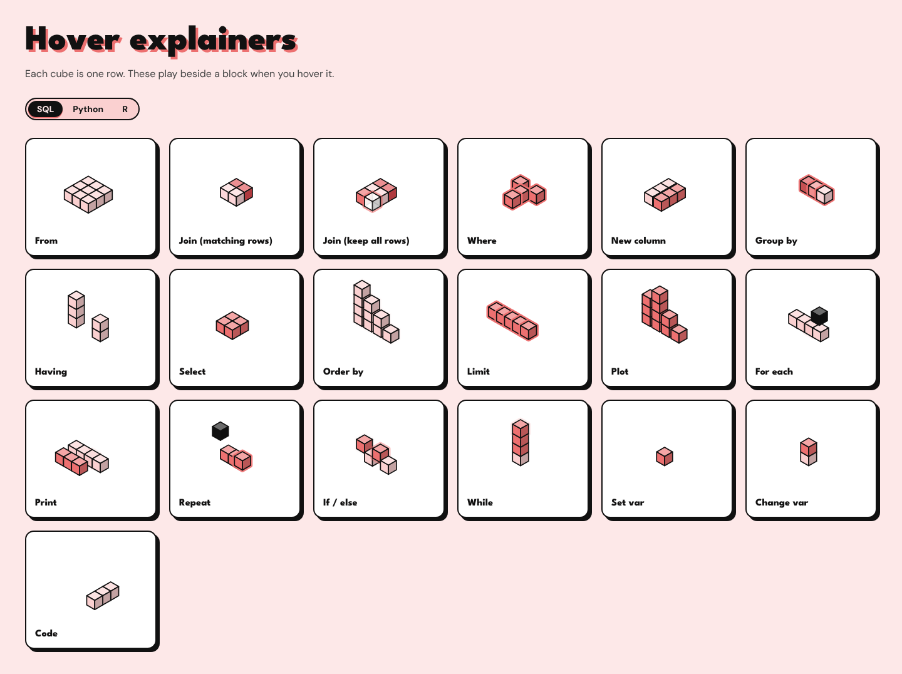

# Architecture

BlockCode is a Python engine behind a stateless JSON API, plus a React editor that keeps each
visitor's work in their own browser. This document explains how the pieces fit together and why
they are built the way they are.

- [The big picture](#the-big-picture)
- [The Program IR](#the-program-ir)
- [One plan, three languages](#one-plan-three-languages)
- [Source maps](#source-maps)
- [Code back to blocks](#code-back-to-blocks)
- [Validation and friendly errors](#validation-and-friendly-errors)
- [Running code](#running-code)
- [CSV ingest](#csv-ingest)
- [The stateless server](#the-stateless-server)
- [The editor](#the-editor)
- [How it is tested](#how-it-is-tested)
- [Design decisions](#design-decisions)
- [Limits and next steps](#limits-and-next-steps)

## The big picture



Blocks and code are two views of one **Program IR**. Every change to the blocks is sent to the
engine, which writes the code for all three languages at once. Every pause while typing in the
code editor sends the text back, and the engine parses it into a new IR. SQL runs on the server;
Python and R run in the visitor's browser. The server keeps nothing between requests, so all of
this works the same on a laptop as on a serverless host.

| Path | What lives there |
| --- | --- |
| `blockcode/ir.py`, `registry.py` | The IR, and the spec for each of the 29 block types |
| `blockcode/plan.py` | From stack → relational plan, with column types tracked at every stage |
| `blockcode/codegen/` | Plan → SQLite, pandas or dplyr (`.R` and Quarto `.qmd`), with a source map |
| `blockcode/parse/` | SQL, Python and R → IR, plus `match.py`, which keeps block ids stable |
| `blockcode/shape.py` | Checks a program is well formed (block types, kinds of setting, size) before any code is written |
| `blockcode/validate.py`, `errors.py` | Per-language problems and plain-English error messages |
| `blockcode/engine.py` | Checks a program, runs it here, or prepares a run for the browser and explains its outcome |
| `blockcode/run/` | Runners for each language (each split into run and interpret), and the subprocess limits in `sandbox.py` |
| `blockcode/data_io.py` | Tidies an uploaded CSV, infers column types, loads it into SQLite |
| `blockcode/server.py`, `cli.py` | The FastAPI app and the `blockcode` command line |
| `web/src/` | The editor: `stack/` (blocks), `code/`, `panels/`, `sidebar/`, `explainers/` |
| `web/src/runtime/` | Python (Pyodide, in a Web Worker) and R (webR) in the browser, with a fallback to the server |

## The Program IR

A program is a list of blocks (`blockcode/ir.py`). Each block has a `type`, an `id`, and three
kinds of children:

- **fields**: plain values chosen in the block, such as a table, a column or a number
- **inputs**: expression slots that hold one expression block each (`cond`, `a`, `b`, …)
- **stacks**: named lists of child blocks (the `steps` of a From block, the `body` of a loop)

A data pipeline is a `from` block whose `steps` stack holds clause blocks: join, new column,
where, group, having, select, order and limit. Conditions and values are round "pill" blocks
plugged into inputs: column, literal, compare, and / or / not, maths, is empty, in list, and text
tests. Python and R also get variables, print, for each, repeat, if / else, while, plot and raw
code blocks. These have no SQL equivalent, so adding one turns the SQL tab off and says why.

The IR knows nothing about any language. The same JSON shape is used by the editor, the CLI, the
`*.blockcode.json` project files, every generator and every parser.

## One plan, three languages

Writing three generators that walk the block tree on their own would be a fast way to get three
subtly different answers. Instead, `plan.py` reduces every From stack to one relational plan:

```
Source → Join* → New column* → Where* → Group / Aggregate → Having → Select → Order → Limit
```

Steps are sorted into clause order first, and a warning is shown if they had to move. While
building the plan, the engine tracks every column's name, type and whether it can be empty,
stage by stage. That is how a dropdown knows which columns exist after a GROUP BY. It also catches
mistakes before any code exists: a column that doesn't exist at that stage, text compared with a
number, maths or a SUM on a text column, a filter with no condition, a variable used inside a
pipeline, or two GROUP BY blocks in one stack.

Each generator walks that same plan:

| Plan step | SQL (SQLite) | pandas | dplyr |
| --- | --- | --- | --- |
| Source | `FROM t` | `pd.read_csv(..., dtype_backend="numpy_nullable")` | `read_csv(...)` |
| Join | `JOIN u USING (k)` | `.merge(u, on="k")` | `inner_join(u, by = "k")` |
| Where | `WHERE …` | boolean mask | `filter(…)` |
| Group / Aggregate | `GROUP BY` + aggregates | `.groupby(..., dropna=False).agg(...)` | `group_by() \|> summarise()` |
| Having | `HAVING …` | mask after the aggregate | `filter(…)` after `summarise` |
| Order / Limit | `ORDER BY` / `LIMIT` | `.sort_values()` / `.head()` | `arrange()` / `slice_head()` |

Making the languages agree on results, not just on shape, takes care at the edges. The main
mismatches are empty values, integer vs float division and text matching:

- pandas reads CSVs with nullable dtypes, so empty values stay `<NA>` and a filter drops them, as
  SQL's three-valued logic does.
- dplyr aggregates use `na.rm = TRUE`, so they skip empty values as SQL does.
- SQLite divides integers as integers, so SQL division is written as `CAST(a AS REAL) / b` to
  match pandas and R.
- SQLite's `LIKE` ignores case, so the "contains / starts with / ends with" tests lowercase both
  sides in pandas (`.str.lower()`) and R (`tolower()` with `fixed()`) too.
- Expression rendering (`codegen/expr.py`) is precedence-aware for each language. It adds
  parentheses only when an operand binds more loosely than its parent needs, so the code reads
  the way a person would write it.

## Source maps

Each generator writes through an `Emitter` (`codegen/emitter.py`), which tags every output line
with the ids of the blocks that produced it. The generators are written to keep that mapping
useful. pandas code is one reassignment per block (`out = out[out["grade"] > 50]`), and dplyr is
one `|>` verb per line. So hovering a block lights up exactly its lines, and an error on line 9 of
the Python points back to the block that wrote line 9.

The parsers record the opposite direction: which lines each new block came from.

## Code back to blocks

Typing in the Code tab, after a short pause, sends the text to `POST /api/parse`. Each language
has its own parser, and each one recognises the subset BlockCode writes, plus the common ways
people write the same thing by hand:

| Language | Parser | Notes |
| --- | --- | --- |
| SQL | [sqlglot](https://github.com/tobymao/sqlglot) (SQLite dialect) AST → plan → blocks | Handles JOIN … USING / ON, WHERE, GROUP BY, HAVING, ORDER BY, LIMIT and aliases |
| Python | the standard `ast` module | Handles reassignment or method chains, `.query()`, `.loc[...]`, `pd.merge`, `df.col`, `.between()`, plus loops, ifs, prints and plots |
| R | a hand-written tokenizer and Pratt parser (`parse/r.py`) | Handles `<-`, `\|>` and `%>%`, dplyr verbs, `for` / `if` / `while`, `print` / `paste` / `cat` and ggplot. In a Quarto document only the ```` ```{r} ```` chunks are read |

Code that can't become blocks is handled carefully:

- **A syntax error** leaves the blocks alone and shows the message on the line.
- **SQL that parses but can't be shown as blocks** (a CTE, a subquery) is reported as
  "not a block yet" on that line. Again, the blocks are left alone.
- **Python or R statements that can't be shown as blocks** become a dashed **Code** block that
  holds the original text, so nothing the learner typed is lost.

**Stable identities.** A naive parse would give every block a new id on every keystroke. Hover
state, plot settings and error links would all reset. `parse/match.py` matches each new block to
the old block in the same place: same parent slot, same type, same position among siblings of
that type. The new block then takes the old block's id.

## Validation and friendly errors

The editor always sends well-formed programs, but the API accepts any JSON. So before anything
else, `shape.py` checks every block: is it a known type, is each setting the right kind of value,
and is the program a sensible size and depth? A malformed block becomes a problem, not a crash,
and every value that reaches the generated code is a quoted literal or a checked identifier.

`validate.py` then merges the problems reported while building the plan and generating code with
checks of its own. For example, a variable used before it is set, a name that isn't a valid
Python identifier, or a plot that would crash or hang: a text column where the chart needs
numbers, a column the rows no longer have, or one bar for each of thousands of rows. Every
problem is attached to a block id. The editor shows it in the Problems tab and outlines the
block, and a run stops on any problem marked as an error before running anything.

Runtime errors are translated too (`errors.py`). An SQLite `no such column` and a pandas
`KeyError` both become "There is no column called grade at this point." The raw error stays
available underneath.

## Running code

| Language | Where it runs | How | Wall-clock limit |
| --- | --- | --- | --- |
| SQL | server | `sqlite3`, against a **read-only** connection (`?mode=ro`); a progress handler stops it from inside, and it fetches 200 rows while counting the rest | 10 s |
| Python | the visitor's browser | [Pyodide](https://pyodide.org) in a Web Worker, so a long program never freezes the page | 20 s |
| R | the visitor's browser | [webR](https://docs.r-wasm.org/webr/), with packages installed from the webR repository on first use | 40 s |
| Python, R (fallback) | server | a subprocess (`python`, or `Rscript` when installed) | 10 s, 20 s |

Each language has a **harness**: a small script around the learner's code that saves plots as
pictures instead of opening windows, reports the final value of each pipeline variable as a
table, and turns a traceback into a line number. The same harness runs in both places. On the
server, `run_python` and `run_r` run it in a subprocess. In the browser, Pyodide or webR runs it
on the visitor's machine. Either way, its raw output goes through the runner's `interpret()`,
which maps the error line back to its block (through the source map), types the table cells
and applies the limits: 200 rows shown, 12 plots and 100,000 characters of printed output.



R plots go to a real picture device (a PNG file on the server, webR's canvas in the browser),
and the harness counts pages with grid and base-graphics hooks. So a plot shows however it's
drawn: a ggplot at the top level, one printed inside a loop, or base graphics. A plot that fails
half way leaves no blank picture behind. (Hooking `print.ggplot` instead, the obvious approach,
silently misses ggplot2 4, whose plots are S7 objects.)

The first run in each language downloads Pyodide or webR, then the packages the program uses
(pandas and matplotlib, or dplyr, readr and ggplot2). Switching to the Python or R tab starts
these downloads early, and the Output panel says what a run is waiting on. If Python or R can't
start in a browser (offline, a blocked CDN, an old browser), the run falls back to the server
and says so.

`run/sandbox.py` adds light guards for the subprocesses:

- a clean environment, so none of the server's tokens or keys are passed in
- CPU-time and file-size limits through `setrlimit`
- output written to files rather than pipes, so a program that prints forever can't fill the
  server's memory
- on Linux, the server process marks itself non-dumpable so the learner's code can't read its
  memory

This is **not** a full sandbox, so running free-typed **Code** blocks on the server is off by
default (`BLOCKCODE_ALLOW_RAW_CODE=1` turns it on). Programs built only from blocks can only
express what the generators emit, so they are always allowed to run. In the browser, Code blocks
run like everything else: the code runs in the visitor's own sandbox, so nothing on the server
is at stake.

## CSV ingest

Real CSVs are messy, and SQLite, pandas and readr each read messy files differently. Rather than
teach three readers about every quirk, `data_io.normalize_csv` rewrites each upload once into
one plain shape. pandas, readr and the SQLite loader then read it with their defaults, and so
they all see the same table:

- **Encodings:** UTF-8, UTF-16, Windows-1252 and Latin-1 are decoded, and binary files are refused.
- **Delimiters:** comma, semicolon, tab or `|` is sniffed from the first lines.
- **Headers:** blank, repeated or padded headers are given names, de-duplicated or trimmed.
- **Empty values:** `NA`, `N/A`, `null`, `#N/A` and friends all become one empty value.
- **Numbers:** `1,234` and `3,5` (a decimal comma) become plain numbers.
- **Ragged rows:** short rows are filled with empty values, and extra values get named columns.

The upload card ("Columns we found") lists every change, so nothing is tidied silently.

## The stateless server



| Endpoint | Purpose |
| --- | --- |
| `GET /api/health` | version, whether R can run here, and where Python and R run |
| `GET /api/runtime` | where Python and R run, and the Pyodide, webR and package-repository URLs |
| `GET /api/blocks` | block specs; the editor builds its palette from these |
| `POST /api/tables` | tidy and inspect an uploaded CSV (column types, empty counts, changes made) |
| `POST /api/generate-all` | code, source map and problems for all three languages at once |
| `POST /api/parse` | code → program, with line spans and diagnostics |
| `POST /api/erd` | inferred links between tables |
| `POST /api/run` | run the program here in the chosen language |
| `POST /api/job` | a Python or R run for the browser: the code, the harness and the tidied CSVs |
| `POST /api/finish` | turn what a browser run produced into a result, errors mapped to blocks |
| `POST /api/export` | a zip of standalone code plus the data it needs |

The only state is in the browser. Requests that need data carry their CSVs, gzipped by the
browser. The server builds a throwaway workspace, uses it and deletes it. This gives three things:

- Visitors can never see each other's data.
- There is no database to run or back up.
- Any number of instances can serve one visitor, which is what makes the Vercel deploy work.

The cost is bandwidth: a run re-sends the tables it uses, and a browser run gets the tidied
tables back (gzipped by the server). Vercel limits a request to 4.5 MB, which is still several
CSVs of a few MB each once gzipped.

## The editor

The web app (`web/`) is React 19 + TypeScript, built with Vite.

- **State** lives in one reducer (`store.tsx`), with undo / redo history. The IR helpers in `ir.ts`
  are immutable, so every edit is a new program and undo is just a stack.
- **Persistence:** `local.ts` saves the title, the blocks and each CSV (as uploaded) in
  IndexedDB, shortly after the last change. **New** clears it.
- **Blocks:** `stack/` renders blocks and pills, with drag and drop through `@dnd-kit` (palette →
  stack, block → block, pill → slot). New blocks start from sensible values; for example, a new
  WHERE starts at the column's median, so it keeps some rows.
- **Code:** `code/CodePanel.tsx` is a CodeMirror 6 editor with SQL, Python and R modes, lint
  squiggles from the parser, and line highlighting from the source map. The learner's own text
  stays in the editor while they type. It is replaced with tidy generated code only when they
  press **Tidy** or switch language.
- **Theming:** each language has its own palette (`theme.ts`), and switching language re-themes
  the whole editor. That way it is always obvious which language you are reading.
- **Explainers:** hovering a block plays a small isometric animation of what it does to the rows
  (`explainers/`). Each animation's story lives in `stories.json`, and a Python test runs the same
  story through the real engine to check that the animation shows the right rows (see below).
  Open `/?gallery` to see them all.

  

- **ERD:** `sidebar/Erd.tsx` draws the inferred schema in crow's foot, Chen or UML notation. Links
  come from columns that share a name, and the "one" side is whichever side's values are unique.

## How it is tested

The engine has over 400 tests. Most of them check that the three languages and the two directions
agree with each other, more than checking any one output:

| Suite | What it checks |
| --- | --- |
| `test_equivalence.py` | SQL, pandas and R return **the same table** for every example program |
| `test_roundtrip.py` | parse(generate(P)) regenerates **identical code** in every language |
| `test_properties.py` | [Hypothesis](https://hypothesis.readthedocs.io) builds random pipelines (joins, nested conditions, groups, …) and checks both properties above |
| `test_golden.py` | generated code for every example is checked in (`tests/golden/`), so changes show up in review |
| `test_parse_handwritten.py` | code written by hand, not by BlockCode, still becomes the right blocks |
| `test_cross_language.py` | edge cases found by exploratory testing to diverge (modulo, ties, LIKE escapes, empty join keys, …), pinned so they stay in step |
| `test_hardening.py` | malformed or hostile programs become problems, never code: bad names, wrong-kind settings, huge or deep programs, runaway SQL |
| `test_awkward_csvs.py` | messy real-world CSVs are tidied, and every language then reads the same table |
| `test_explainers.py` | every hover animation shows what the engine really does (e.g. inner join 3 + 3 → 2 rows) |
| `test_export.py` | exported files run on their own, outside BlockCode |
| `test_browser_jobs.py` | a stand-in browser runs every job exactly as handed over, and must get the same result as a run on the server |
| `test_plots.py` | bad plot settings are problems on the block; R draws plots made any way (loops, ggplot2 3 or 4); failures leave no blank picture |
| `test_server.py`, `test_cli.py` | the API and the command line |

On the web side, Vitest covers the IR helpers and the animation scenes. Playwright runs 15
end-to-end tests against the real engine: upload, build, switch language, run, type code, drag
and drop, export, and error → block links. Two of them cover the browser runtime: one checks
that runs fall back to the server when Pyodide and webR can't be downloaded, and one runs Python
and R for real in the browser, plots and all, where the CDNs are reachable (as in CI). CI runs
lint, the engine tests (with R installed), the web build and unit tests, and the browser tests
on every pull request.

## Design decisions

| Decision | Why | Trade-off |
| --- | --- | --- |
| A custom React stack editor, not Blockly | The v4 design needed clause blocks with inline dropdowns, round condition pills and per-language theming. Fighting Blockly's rendering would have cost more than building it. | Drag and drop, snapping and accessibility had to be built and tested by hand. |
| One relational plan shared by all three generators | Agreement between languages comes from the structure, not from three separate implementations. | Programs are limited to what the plan can express (no subqueries or window functions yet). |
| Parse into the IR, don't diff the text | The IR is the single source of truth. Any code that parses yields a whole, valid program. | Each language needs its own parser for its subset. |
| A hand-written R parser | Parsing must work where R isn't installed (Vercel), so asking R itself is out. The dplyr subset is small enough for a Pratt parser in about 800 lines, with errors phrased for learners. | Unusual R syntax falls back to a raw Code block. |
| A stateless server with workspaces kept in the browser | Privacy by construction, no database, and it scales out on serverless hosts. | Each run re-uploads its tables. Work lives in one browser unless exported. |
| Tidy every CSV once on the way in | One tidy file means SQLite, pandas and readr agree without three sets of reader options. | Dates stay text for now. |
| Run Python and R in the visitor's browser (WebAssembly) | Nothing to install, R works on hosts without it (Vercel), and untrusted code runs in the visitor's own sandbox, not the server's. | The first run downloads tens of MB, and WebAssembly is slower than native. The server stays as a fallback. |
| One harness, interpreted on the server | The browser and the server run the same harness, and the server explains both outputs the same way, so the two can't drift apart. | Every browser run makes two requests (`/job`, `/finish`). |
| Free-typed code is off by default on the server | The subprocess limits are guards, not isolation. | On the server, raw Code blocks run only on trusted hosts (a local install, the Docker image with the flag set). They always run in the browser. |

## Limits and next steps

Known differences between the languages, kept deliberately visible:

- `SUM` over a group whose values are all empty gives empty in SQL, but in some programs the
  pandas code still gives 0. This is a known bug, and the property tests can find it.
- A new column that a later GROUP BY or SELECT drops has no SQL of its own. The validator warns
  about this.

What comes next:

- **Not yet blocks:** subqueries and CTEs, window functions, CASE, LIKE patterns with `%` or `_`
  in the middle, functions, and date types.
- **Keep the tidied CSVs in the browser.** Browser runs still send each table to the server to
  be tidied and get it back. Storing the tidied file at upload time would let Python and R runs
  skip that round trip, so the data would never leave the browser for a run.
- **Auto-run.** Re-run after each edit once the first run is done, keeping results in step with
  the blocks.
- **A compare mode** that runs all three languages side by side and shows that the results match.
